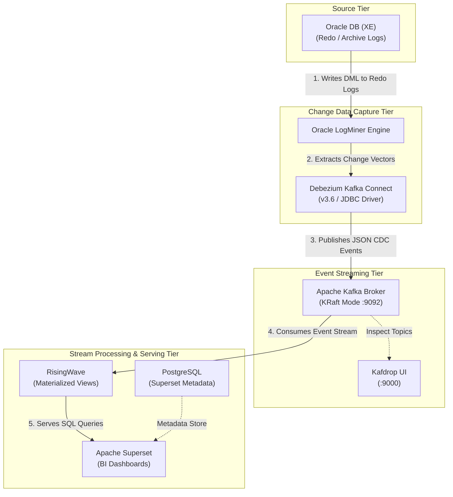

# Oracle to RisingWave Real-Time CDC Streaming Pipeline

> A low-latency, event-driven Change Data Capture (CDC) pipeline capturing Oracle DB transactions via LogMiner and streaming them to RisingWave and Apache Superset using Debezium and Apache Kafka.

---

## Overview

### Purpose & Objective
This project builds a production-grade, open-source real-time Change Data Capture (CDC) and stream processing architecture. The primary objective is to capture row-level database modification events (DML) from an Oracle transactional database without application code changes, stream them through a message broker, maintain incrementally updated materialized views, and expose live analytics via dashboards.

### Problem Solved
Traditional batch-based ETL processes introduce significant data latency, heavy query loads on transactional source databases during extract windows, and delayed decision-making capabilities. This solution provides continuous, low-latency streaming analytics while minimizing read overhead on the source Oracle database.

---

## Architecture

The system follows an end-to-end streaming data architecture:

1. **Source Tier**: Oracle DB logs DML transactions to Redo Logs.
2. **CDC Capture Tier**: Debezium Connect uses Oracle LogMiner to mine transaction logs without agents.
3. **Event Broker Tier**: Apache Kafka (KRaft mode) buffers CDC events in dedicated topics.
4. **Stream Processing Tier**: RisingWave consumes raw Kafka events and maintains real-time Materialized Views using SQL.
5. **Serving & Visualization Tier**: Apache Superset executes queries against RisingWave materialized views to render real-time dashboards.



---

## Technologies

| Category | Technology | Version | Container / Service Name | Purpose & Role |
| :--- | :--- | :--- | :--- | :--- |
| **Source Database** | Oracle Database XE | 18c / XE | `oracle` | Source database generating Redo/Archive logs |
| **CDC Engine** | Debezium Connect | `3.6` | `connect` | LogMiner wrapper converting logs to CDC events |
| **Message Broker** | Apache Kafka | KRaft | `kafka` | Distributed event streaming broker (`:9092`) |
| **Broker UI** | Kafdrop | Latest | `kafdrop` | Web UI for viewing Kafka topics and payload structures |
| **Stream Processing** | RisingWave | Latest | `risingwave` | SQL stream database creating live Materialized Views |
| **Analytics & BI** | Apache Superset | Custom Image | `superset` | BI dashboarding engine querying RisingWave |
| **Metadata Store** | PostgreSQL | Latest | `postgres` | Backing store for Superset configuration metadata |

---

## How It Works

1. **Transaction Execution**: DML operations (`INSERT`, `UPDATE`, `DELETE`) execute on the Oracle application database (`XEPDB1`).
2. **Redo Logging & Archiving**: Oracle writes transactional changes into cyclic Redo Logs. When full, logs transition to Archive Logs.
3. **Log Mining**: Debezium's Oracle connector polls Oracle LogMiner to extract transactional change vectors.
4. **CDC Event Generation**: Debezium formats change events into structured JSON messages containing `before`, `after`, and source metadata structures.
5. **Topic Streaming**: Messages stream to Apache Kafka on port `9092`.
6. **Materialized View Processing**: RisingWave consumes Kafka topics, interprets CDC UPSERT semantics, and updates Materialized Views in memory.
7. **Live Visualization**: Superset queries RisingWave views on demand to reflect real-time analytical metrics.

---

## Project Structure

```
project/
├── .env                              # Centralized Docker environment variables
├── docker/
│   ├── compose/
│   │   └── docker-compose.yml        # Multi-container orchestration definition
│   ├── oracle/
│   │   ├── initdb/                   # Database initialization scripts (01-05)
│   │   └── healthcheck/              # Oracle readiness check script
│   ├── connect/
│   │   ├── Dockerfile                # Custom Debezium image with Oracle JDBC drivers
│   │   ├── connectors/               # Debezium JSON connector parameters
│   │   └── scripts/                  # Connector management & test scripts (.ps1)
│   ├── risingwave/sql/               # Source tables, materialized views & queries
│   ├── postgres/initdb/              # Superset metadata DB initialization
│   └── superset/                     # Custom Superset Dockerfile & python drivers
├── scripts/
│   ├── host/                         # Automation & stack control scripts (.ps1)
│   └── sql/                          # Reusable DML test scripts
├── docs/                             # Troubleshooting and architectural guides
└── k8s/                              # Kubernetes manifests for production deployment
```

---

## Key Components

* **Oracle DB Container (`oracle`)**: Configured with multitenant architecture (`CDB$ROOT` for admin/LogMiner, `XEPDB1` for application data).
* **Debezium Connect (`connect`)**: Runs on port `8083`. Uses custom-mounted Oracle JDBC drivers (`ojdbc8.jar`) to communicate with LogMiner.
* **Apache Kafka (`kafka`)**: Runs in KRaft mode (no Zookeeper required). Listens internally on `kafka:9092` and externally on `localhost:29092`.
* **RisingWave (`risingwave`)**: Native SQL stream processing engine that ingests Debezium JSON streams directly.
* **Apache Superset (`superset`)**: Custom build containing `psycopg2-binary` to enable direct connection to RisingWave / PostgreSQL databases.

---

## Data Flow & CDC Details

### Payload Format
Debezium serializes keys and values into JSON with explicit schema definitions:
* **`op` Field**: `c` (Create/Insert), `u` (Update), `d` (Delete), `r` (Snapshot Read).
* **Payload Structure**:
  * `before`: State prior to transaction.
  * `after`: State following transaction.
  * `source`: Metadata (SCN, LSN, Timestamp, Table, Schema).

### Data Type Behaviors & Limitations
* **Scalar Columns**: Full `before` and `after` support with high throughput.
* **CLOB / XMLTYPE**: Streamed directly as text string payloads.
* **BLOB**: Converted and published as Base64 encoded strings.
* **LOB Limitation**: Oracle LogMiner **does not generate `before` images** for LOB data types. Only `after` values are present during updates.

---

## Configuration & Setup

### Prerequisites
* Docker & Docker Compose
* PowerShell 5.1+ (for execution scripts)
* Git

### Step-by-Step Installation

1. **Start the Service Stack**
   ```powershell
   docker compose --env-file .env -f .\docker\compose\docker-compose.yml up -d
   ```

2. **Initialize Oracle Database**
   Enter the Oracle container and execute setup scripts in order:
   ```bash
   docker exec -it oracle bash
   sqlplus / as sysdba
   ```
   Execute inside `sqlplus`:
   ```sql
   @/container-entrypoint-initdb.d/01-enable-archivelog.sql
   @/container-entrypoint-initdb.d/02-configure-cdc.sql
   @/container-entrypoint-initdb.d/03-create-app-schema.sql
   @/container-entrypoint-initdb.d/04-seed-sample-data.sql
   @/container-entrypoint-initdb.d/05-configure-cdc-lob-logging.sql
   ```

3. **Register Debezium Oracle Connector**
   From the host machine PowerShell prompt:
   ```powershell
   .\docker\connect\scripts\register-oracle-connector.ps1
   ```

4. **Verify Connector Health**
   ```powershell
   .\docker\connect\scripts\check-connector-status.ps1
   ```
   *Expected Output: Both `connector` and `tasks` state must report `RUNNING`.*

5. **Validate Pipeline Stream**
   ```powershell
   .\docker\connect\scripts\quick-insert-test.ps1
   ```

---

## Testing & Validation

Benchmarking and validation scenarios conducted during development:

| Test Scenario | Minimum Latency | Median Latency | Average Latency | Maximum Latency | Number Of Rows Tested |
| :--- | :--- | :--- | :--- | :--- | :--- |
| **Insert Benchmark** | **0.221s** | **3.092s**  | **3.105s** | **13.867s** | **500,000** |


---

## Challenges & Solutions

### 1. Archivelog Enablement Error
* **Problem**: Oracle script failed when attempting to enable `ARCHIVELOG` mode while the database was running.
* **Solution**: Script modified to execute `SHUTDOWN IMMEDIATE`, followed by `STARTUP MOUNT`, `ALTER DATABASE ARCHIVELOG`, and `ALTER DATABASE OPEN`.

### 2. Debezium Connector Task Failure
* **Problem**: Connector status showed `RUNNING`, but tasks failed due to insufficient permissions.
* **Solution**: Explicit grants applied to the CDC user across all database containers:
  ```sql
  GRANT LOGMINING TO C##DBZUSER CONTAINER = ALL;
  GRANT CREATE TABLE TO C##DBZUSER CONTAINER = ALL;
  GRANT CREATE SEQUENCE TO C##DBZUSER CONTAINER = ALL;
  ```

### 3. Missing Database Drivers in Superset
* **Problem**: Lean Superset official base images lacked Postgres/RisingWave drivers.
* **Solution**: Created a custom `Dockerfile` under `docker/superset/` injecting `psycopg2-binary` during image build.

---

## Design Decisions

* **LogMiner vs. Alternatives**: Selected Oracle LogMiner because it requires no additional licensing fees.
  * *Rejected Alternatives*: Oracle XStream (requires expensive licensing), GoldenGate (requires additional paid infrastructure), and OpenLogReplicator (adds unnecessary architectural complexity).
* **KRaft vs. Zookeeper**: Adopted Kafka KRaft mode to simplify cluster architecture and reduce resource usage by eliminating Zookeeper.
* **RisingWave for Stream Processing**: Chosen for native PostgreSQL compatibility, stream-native incremental view maintenance, and lower operational overhead compared to heavy Flink/Spark clusters.

---

## Limitations

1. **Missing LOB `before` Images**: Oracle LogMiner does not write `before` states for LOB/XMLTYPE columns into Redo Logs.
2. **LOB Performance Penalty**: LOB updates introduce ~75x higher latency overhead compared to scalar data types (5.888s vs 0.078s per 1000 updates).
3. **BLOB Encoding**: Downstream consumers must decode Base64 binary values into original formats.

---

## Component Latency & Alternatives

> **Research only.** None of the alternatives below was installed, configured, or benchmarked in this project. The "expected latency" figures come from published measurements, vendor documentation, or statements by maintainers and users, each cited in [Sources](#sources). Where nobody has published a number, the table says so instead of guessing.

### How the current latency was measured

`end-to-end latency = RisingWave echo-sink Kafka timestamp − SRC_TS_US`

* **Start (`SRC_TS_US`)**: Oracle clock read just before the `INSERT`. It includes the `INSERT` and `COMMIT`.
* **End**: Kafka timestamp of the RisingWave echo sink, about 50 ms before the row is visible to a query.
* **Run**: 100,000 committed single-row inserts on Minikube (2 × 50,000, 27 Sep 2026), single host clock. Each row had XMLTYPE, CLOB and BLOB columns.

| Stage | Start → End timestamp | Median | P99 | Mean | Share of mean |
| :--- | :--- | :--- | :--- | :--- | :--- |
| **Capture (Oracle LogMiner + Debezium)** | row source ts → Debezium `ts_ms` | **2.25s** | 4.60s | 2.26s | **74.6%** |
| **Hand-off (Debezium → Kafka)** | Debezium `ts_ms` → Kafka `CreateTime` | 0.25s | 0.50s | 0.25s | 8.4% |
| **Processing (Kafka → RisingWave)** | Kafka `CreateTime` → RisingWave echo | 0.48s | 1.03s | 0.52s | 17.0% |
| **End-to-end** | `SRC_TS_US` → RisingWave echo | **3.03s** | 5.59s | **3.03s** | 100% |

Debezium released events in batches with a median gap of **3.16 s**, about 560 events per batch. This mining cycle is the main cost in the capture stage. A Debezium maintainer gives the same baseline: *"on average a 3 second latency is expected when the connector is working in ideal conditions"* for the LogMiner adapter [1].

### Why LogMiner is slow

* **Polling, not streaming**: Debezium runs LogMiner in repeated mining sessions. Each poll starts a session, loads redo into memory, then queries `V$LOGMNR_CONTENTS`. The maintainer says this *"can take a few seconds on each poll"* [2].
* **Oracle-imposed delay**: Even with Debezium's sleep settings at 0, users *"may observe upwards of several seconds latency"*. Users with 4–16 GB redo logs reported 5–20 s [3].
* **Log switches**: With the default strategy, every log switch rebuilds the data dictionary. This can take *"30 seconds up to several minutes"* [4]. This project already uses `online_catalog`, which avoids that rebuild.
* **Debezium 3.6** (the version used here) removed the `log.mining.sleep.time.*` and `batch.size.*` tuning. It now uses a single `log.mining.log.count.min` property and claims *"near real-time event dispatch"* when caught up. The post gives no latency figures [5].

### Alternatives to Oracle LogMiner (capture stage)

**Projected end-to-end** = published capture latency of the alternative + the **0.77 s** this project measured for hand-off and processing (0.25 s + 0.52 s mean). It is an estimate, not a measurement. Tools that also replace Debezium (GoldenGate, Striim, HVR, Qlik) replace the hand-off stage too, so their projection is less precise.

| Component | Current latency (measured) | Alternative | License | Expected capture latency (published evidence) | Projected end-to-end |
| :--- | :--- | :--- | :--- | :--- | :--- |
| Oracle LogMiner via Debezium `logminer` adapter | **2.25s** median capture, **3.03s** end-to-end | **OpenLogReplicator** (Debezium `olr` adapter) | Free / open source | **~11.7 ms** typical, INSERT → Kafka, measured by the author on Oracle 19c, spikes during checkpoints (2020 home-lab test, default settings) [6]. Reads redo files directly, no LogMiner session. | **~0.8s** |
| | | **Oracle GoldenGate** (Integrated Extract + GoldenGate for Big Data Kafka handler) | Oracle GoldenGate license | Oracle markets *"sub-second latency"* [7]. Equinix reports sub-second end-to-end over WAN (vendor test) [8]. One user reported 10–15 s lag with downstream integrated capture (2014 forum) [9]. No independent benchmark found. | **~1–2s** (best case) |
| | | **Oracle XStream** (Debezium `xstream` adapter) | GoldenGate license required [10] | No published measurement. Oracle *"explicitly pauses for 1 second"* when no data is available (Debezium maintainer) [11]. Confluent: up to **~3 s** extra at low activity from XStream batching, which continuous activity *"typically removes"* [12]. | **~1–4s** (depends on load) |
| | | **Confluent Oracle XStream CDC Source** connector | Confluent Enterprise (includes XStream rights) | Same XStream engine: up to ~3 s extra latency at low activity, not configurable [12]. Lists Oracle 19c/21c EE/SE; XE is not listed. | **~1–4s** |
| | | **Striim OJet** | Commercial | **1.9 s** average end-to-end, Oracle → BigQuery, 3 billion events/day (vendor benchmark). Read-lag under 2 s up to 160 GB/h of CDC data [13]. | **~2–2.7s** |
| | | **Fivetran HVR** (direct redo read) | Commercial | *"at least one to two seconds of capture latency"* due to efficiency optimizations (Fivetran docs) [14]. | **~1.8–2.8s** |
| | | **Qlik Replicate** (Binary Reader) | Commercial | No per-event figure published. Qlik claims *"greatly improved performance"* vs LogMiner [15]. A community log showed 6.9 s source latency; the reader type was not stated [16]. | Not published |
| | | **Confluent Oracle CDC Source** (LogMiner-based) | Confluent Enterprise | No figure published. Same LogMiner engine, so expect the same latency class as the current setup [17]. | **~3s** (no gain expected) |
| | | **Debezium `logminer_unbuffered`** (committed-data-only, Debezium 3.2+) | Free / open source | No figure published. Oracle buffers transactions in PGA instead of the connector. The benefit is memory, not latency, and it is still bound by LogMiner sessions [18]. | **~3s** (no gain expected) |

### Alternatives for the other components

The other two stages take 25% of the latency together. Their measured shape matches each component's default cadence, which points to a setting rather than the technology:

| Component | Current latency (measured) | Alternative | License | Expected latency (published evidence) | Expected gain |
| :--- | :--- | :--- | :--- | :--- | :--- |
| Apache Kafka (with Debezium hand-off) | 0.25s median / 0.50s P99 | **Redpanda** | Community / commercial | Independent test, Kafka 4.2 vs Redpanda 26.1: p99 **3–4 ms** vs **3–6 ms**; Kafka was faster with `acks=all` [19]. Redpanda's own benchmarks claim 10× lower tail latency at high throughput [20]. | **None**: the broker takes milliseconds. The uniform 0–0.5 s spread matches Debezium's default `poll.interval.ms` of 500 ms. |
| RisingWave | 0.48s median / 1.03s P99 | **Apache Flink** | Free / open source | RisingWave's benchmark (vendor): projection query p50 **180 ms** RisingWave vs **220 ms** Flink; join+aggregation p99 **980 ms** vs **4,200 ms** [21]. Flink exactly-once sinks wait for its checkpoint interval [22]. | **None**: the 0–1 s spread matches RisingWave's default `barrier_interval_ms` of 1000 ms [23]. |

### Summary

* **The capture stage is the only one worth replacing.** Even a zero-latency Kafka and RisingWave would leave about 2.25 s of capture latency.
* **OpenLogReplicator** is the only **free** option with a published millisecond-level capture measurement. It could bring end-to-end latency from about **3.0 s to about 0.8 s**. It is incubating in Debezium. Third-party docs list Oracle XE as supported and the upstream tutorials run on Oracle 21c XE, but RAC is not supported.
* **GoldenGate / XStream** are Oracle's supported paths with sub-second claims. Both need a GoldenGate license, and no independent latency benchmark was found.
* **Striim, Fivetran HVR and Qlik Replicate** publish figures of about 1–2 s. That is a modest gain over the current 2.25 s capture for the license cost.
* Every number in this section comes from a different environment. A benchmark on this pipeline, with the same `SRC_TS_US` → RisingWave echo definition, is needed before any decision.

### Sources

1. [Debezium Google Group — "High latency with Oracle database" (Chris Cranford, maintainer, Sep 2022)](https://groups.google.com/g/debezium/c/WnS0JZoTP4s)
2. [Debezium Google Group — "Performance LogMiner vs XStream" (Jan 2021)](https://groups.google.com/g/debezium/c/3b23GyOtY74/m/RicR0gtAAgAJ)
3. [Debezium Google Group — "Performance Debezium" (Chris Cranford, Aug 2024)](https://groups.google.com/g/debezium/c/MgeW-Ny3_3s)
4. [Debezium blog — Debezium for Oracle, Part 3: Performance and Debugging (Jun 2023)](https://debezium.io/blog/2023/06/29/debezium-oracle-series-part-3/)
5. [Debezium blog — Oracle LogMiner: no more tuning (Debezium 3.6, Jul 2026)](https://debezium.io/blog/2026/07/06/oracle-logminer-no-more-tuning/)
6. [Adam Leszczyński — OpenLogReplicator replication latency (May 2020)](https://www.bersler.com/blog/openlogreplicator-replication-latency/)
7. [Oracle GoldenGate overview slides ("sub-second latency")](https://www.slideshare.net/slideshow/oracle-goldengate-for-mysql-overview/70677282)
8. [Equinix — Maximize the Capabilities of Oracle GoldenGate (2018)](https://blog.equinix.com/blog/2018/06/27/maximize-the-capabilities-of-oracle-goldengate/)
9. [Oracle Forums — How to minimize replication latency lag](https://forums.oracle.com/ords/apexds/post/how-to-minimize-replication-latency-lag-for-specific-table-4064)
10. [Debezium Connector for Oracle — documentation (XStream, OLR, unbuffered adapters)](https://debezium.io/documentation/reference/stable/connectors/oracle.html)
11. [Debezium Google Group — "Debezium 1.9 Oracle XStream performance issue" (Apr 2022)](https://groups.google.com/g/debezium/c/aASYXcyiGJs)
12. [Confluent — Oracle XStream CDC Source Connector overview](https://docs.confluent.io/kafka-connectors/oracle-xstream-cdc-source/current/overview.html)
13. [Striim — Oracle to BigQuery data integration white paper](https://go2.striim.com/hubfs/wp_data_integration_oracle_bigquery%20(1).pdf)
14. [Fivetran — Optimize database log-based CDC performance](https://fivetran.com/docs/connectors/databases/troubleshooting/optimize-cdc-performance)
15. [Qlik — Oracle: Optimizing read speeds using Oracle ASM storage](https://community.qlik.com/t5/Official-Support-Articles/Oracle-Optimizing-read-speeds-using-Oracle-ASM-storage/ta-p/1712080)
16. [Qlik Community — Qlik Replicate Latency](https://community.qlik.com/t5/Data-Movement-Streaming/Qlik-Replicate-Latency/m-p/1959965)
17. [Confluent — Oracle CDC Source Connector overview](https://docs.confluent.io/kafka-connectors/oracle-cdc/current/overview.html)
18. [Debezium blog — Debezium 3.2.0.Alpha1 released (unbuffered LogMiner adapter)](https://debezium.io/blog/2025/04/29/debezium-3-2-alpha1-released/)
19. [ComputingForGeeks — Kafka vs Redpanda benchmarks](https://computingforgeeks.com/kafka-vs-redpanda-benchmarks/)
20. [Redpanda — Redpanda vs. Kafka performance benchmark](https://redpanda.com/blog/redpanda-vs-kafka-performance-benchmark)
21. [RisingWave — Flink vs RisingWave real-time analytics benchmark](https://risingwave.com/blog/flink-vs-risingwave-real-time-analytics-benchmark)
22. [RisingWave — Flink exactly-once vs RisingWave exactly-once](https://risingwave.com/blog/flink-exactly-once-vs-risingwave-exactly-once)
23. [RisingWave — View and configure system parameters](https://docs.risingwave.com/docs/current/view-configure-system-parameters/)

---

## Results

* Successfully implemented a fully functioning, zero-license real-time CDC pipeline from Oracle XE to RisingWave and Superset.
* Verified real-time streaming, serialization, and stream-processing capabilities for scalar, CLOB, BLOB, and XMLTYPE data types.

---

## Future Improvements

* **Spark Streaming Layer**: Introduce an intermediate Apache Spark Streaming layer between Kafka and RisingWave for heavy stream transformations and enrichment.
* **Gold Layer & Fact Modeling**: Implement analytical dimensional models (Star Schema / Fact tables) within the target serving layer.
* **Production K8s Deployment**: Migrate local Docker Compose setup to Kubernetes using provided manifests under `k8s/`.

---
