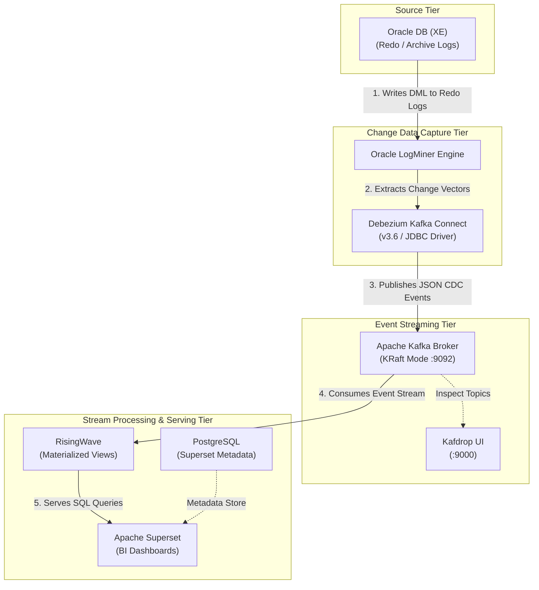

# Oracle to RisingWave Real-Time CDC Streaming Pipeline

> A low-latency, event-driven Change Data Capture (CDC) pipeline capturing Oracle DB transactions via LogMiner and streaming them to RisingWave and Apache Superset using Debezium and Apache Kafka.

---

## Overview

### Purpose & Objective
This project builds a production-grade, open-source real-time Change Data Capture (CDC) and stream processing architecture. The primary objective is to capture row-level database modification events (DML) from an Oracle transactional database without application code changes, stream them through a message broker, maintain incrementally updated materialized views, and expose live analytics via dashboards.

### Problem Solved
Traditional batch-based ETL processes introduce significant data latency, heavy query loads on transactional source databases during extract windows, and delayed decision-making capabilities. This solution provides continuous, low-latency streaming analytics while minimizing read overhead on the source Oracle database.

---

## Architecture

The system follows an end-to-end streaming data architecture:

1. **Source Tier**: Oracle DB logs DML transactions to Redo Logs.
2. **CDC Capture Tier**: Debezium Connect uses Oracle LogMiner to mine transaction logs without agents.
3. **Event Broker Tier**: Apache Kafka (KRaft mode) buffers CDC events in dedicated topics.
4. **Stream Processing Tier**: RisingWave consumes raw Kafka events and maintains real-time Materialized Views using SQL.
5. **Serving & Visualization Tier**: Apache Superset executes queries against RisingWave materialized views to render real-time dashboards.



---

## Technologies

| Category | Technology | Version | Container / Service Name | Purpose & Role |
| :--- | :--- | :--- | :--- | :--- |
| **Source Database** | Oracle Database XE | 18c / XE | `oracle` | Source database generating Redo/Archive logs |
| **CDC Engine** | Debezium Connect | `3.6` | `connect` | LogMiner wrapper converting logs to CDC events |
| **Message Broker** | Apache Kafka | KRaft | `kafka` | Distributed event streaming broker (`:9092`) |
| **Broker UI** | Kafdrop | Latest | `kafdrop` | Web UI for viewing Kafka topics and payload structures |
| **Stream Processing** | RisingWave | Latest | `risingwave` | SQL stream database creating live Materialized Views |
| **Analytics & BI** | Apache Superset | Custom Image | `superset` | BI dashboarding engine querying RisingWave |
| **Metadata Store** | PostgreSQL | Latest | `postgres` | Backing store for Superset configuration metadata |

---

## How It Works

1. **Transaction Execution**: DML operations (`INSERT`, `UPDATE`, `DELETE`) execute on the Oracle application database (`XEPDB1`).
2. **Redo Logging & Archiving**: Oracle writes transactional changes into cyclic Redo Logs. When full, logs transition to Archive Logs.
3. **Log Mining**: Debezium's Oracle connector polls Oracle LogMiner to extract transactional change vectors.
4. **CDC Event Generation**: Debezium formats change events into structured JSON messages containing `before`, `after`, and source metadata structures.
5. **Topic Streaming**: Messages stream to Apache Kafka on port `9092`.
6. **Materialized View Processing**: RisingWave consumes Kafka topics, interprets CDC UPSERT semantics, and updates Materialized Views in memory.
7. **Live Visualization**: Superset queries RisingWave views on demand to reflect real-time analytical metrics.

---

## Project Structure

```
project/
├── .env                              # Centralized Docker environment variables
├── docker/
│   ├── compose/
│   │   └── docker-compose.yml        # Multi-container orchestration definition
│   ├── oracle/
│   │   ├── initdb/                   # Database initialization scripts (01-05)
│   │   └── healthcheck/              # Oracle readiness check script
│   ├── connect/
│   │   ├── Dockerfile                # Custom Debezium image with Oracle JDBC drivers
│   │   ├── connectors/               # Debezium JSON connector parameters
│   │   └── scripts/                  # Connector management & test scripts (.ps1)
│   ├── risingwave/sql/               # Source tables, materialized views & queries
│   ├── postgres/initdb/              # Superset metadata DB initialization
│   └── superset/                     # Custom Superset Dockerfile & python drivers
├── scripts/
│   ├── host/                         # Automation & stack control scripts (.ps1)
│   └── sql/                          # Reusable DML test scripts
├── docs/                             # Troubleshooting and architectural guides
└── k8s/                              # Kubernetes manifests for production deployment
```

---

## Key Components

* **Oracle DB Container (`oracle`)**: Configured with multitenant architecture (`CDB$ROOT` for admin/LogMiner, `XEPDB1` for application data).
* **Debezium Connect (`connect`)**: Runs on port `8083`. Uses custom-mounted Oracle JDBC drivers (`ojdbc8.jar`) to communicate with LogMiner.
* **Apache Kafka (`kafka`)**: Runs in KRaft mode (no Zookeeper required). Listens internally on `kafka:9092` and externally on `localhost:29092`.
* **RisingWave (`risingwave`)**: Native SQL stream processing engine that ingests Debezium JSON streams directly.
* **Apache Superset (`superset`)**: Custom build containing `psycopg2-binary` to enable direct connection to RisingWave / PostgreSQL databases.

---

## Data Flow & CDC Details

### Payload Format
Debezium serializes keys and values into JSON with explicit schema definitions:
* **`op` Field**: `c` (Create/Insert), `u` (Update), `d` (Delete), `r` (Snapshot Read).
* **Payload Structure**:
  * `before`: State prior to transaction.
  * `after`: State following transaction.
  * `source`: Metadata (SCN, LSN, Timestamp, Table, Schema).

### Data Type Behaviors & Limitations
* **Scalar Columns**: Full `before` and `after` support with high throughput.
* **CLOB / XMLTYPE**: Streamed directly as text string payloads.
* **BLOB**: Converted and published as Base64 encoded strings.
* **LOB Limitation**: Oracle LogMiner **does not generate `before` images** for LOB data types. Only `after` values are present during updates.

---

## Configuration & Setup

### Prerequisites
* Docker & Docker Compose
* PowerShell 5.1+ (for execution scripts)
* Git

### Step-by-Step Installation

1. **Start the Service Stack**
   ```powershell
   docker compose --env-file .env -f .\docker\compose\docker-compose.yml up -d
   ```

2. **Initialize Oracle Database**
   Enter the Oracle container and execute setup scripts in order:
   ```bash
   docker exec -it oracle bash
   sqlplus / as sysdba
   ```
   Execute inside `sqlplus`:
   ```sql
   @/container-entrypoint-initdb.d/01-enable-archivelog.sql
   @/container-entrypoint-initdb.d/02-configure-cdc.sql
   @/container-entrypoint-initdb.d/03-create-app-schema.sql
   @/container-entrypoint-initdb.d/04-seed-sample-data.sql
   @/container-entrypoint-initdb.d/05-configure-cdc-lob-logging.sql
   ```

3. **Register Debezium Oracle Connector**
   From the host machine PowerShell prompt:
   ```powershell
   .\docker\connect\scripts\register-oracle-connector.ps1
   ```

4. **Verify Connector Health**
   ```powershell
   .\docker\connect\scripts\check-connector-status.ps1
   ```
   *Expected Output: Both `connector` and `tasks` state must report `RUNNING`.*

5. **Validate Pipeline Stream**
   ```powershell
   .\docker\connect\scripts\quick-insert-test.ps1
   ```

---

## Testing & Validation

Benchmarking and validation scenarios conducted during development:

| Test Scenario | Executed Script | Observed Latency / Behavior | Status |
| :--- | :--- | :--- | :--- |
| **Insert Benchmark** | `Inserting 500k Sequential Rows` | **Average: 3.1 Seconds**  | Passed |

| Test Scenario | Minimum Latency | Median Latency | Average Latency | Maximum Latency | Number Of Rows Tested |
| :--- | :--- | :--- | :--- | :--- | :--- |
| **Insert Benchmark** | **0.221s** | **3.092s**  | **3.105s** | **13.867s** | **500,000** |


---

## Challenges & Solutions

### 1. Archivelog Enablement Error
* **Problem**: Oracle script failed when attempting to enable `ARCHIVELOG` mode while the database was running.
* **Solution**: Script modified to execute `SHUTDOWN IMMEDIATE`, followed by `STARTUP MOUNT`, `ALTER DATABASE ARCHIVELOG`, and `ALTER DATABASE OPEN`.

### 2. Debezium Connector Task Failure
* **Problem**: Connector status showed `RUNNING`, but tasks failed due to insufficient permissions.
* **Solution**: Explicit grants applied to the CDC user across all database containers:
  ```sql
  GRANT LOGMINING TO C##DBZUSER CONTAINER = ALL;
  GRANT CREATE TABLE TO C##DBZUSER CONTAINER = ALL;
  GRANT CREATE SEQUENCE TO C##DBZUSER CONTAINER = ALL;
  ```

### 3. Missing Database Drivers in Superset
* **Problem**: Lean Superset official base images lacked Postgres/RisingWave drivers.
* **Solution**: Created a custom `Dockerfile` under `docker/superset/` injecting `psycopg2-binary` during image build.

---

## Design Decisions

* **LogMiner vs. Alternatives**: Selected Oracle LogMiner because it requires no additional licensing fees.
  * *Rejected Alternatives*: Oracle XStream (requires expensive licensing), GoldenGate (requires additional paid infrastructure), and OpenLogReplicator (adds unnecessary architectural complexity).
* **KRaft vs. Zookeeper**: Adopted Kafka KRaft mode to simplify cluster architecture and reduce resource usage by eliminating Zookeeper.
* **RisingWave for Stream Processing**: Chosen for native PostgreSQL compatibility, stream-native incremental view maintenance, and lower operational overhead compared to heavy Flink/Spark clusters.

---

## Limitations

1. **Missing LOB `before` Images**: Oracle LogMiner does not write `before` states for LOB/XMLTYPE columns into Redo Logs.
2. **LOB Performance Penalty**: LOB updates introduce ~75x higher latency overhead compared to scalar data types (5.888s vs 0.078s per 1000 updates).
3. **BLOB Encoding**: Downstream consumers must decode Base64 binary values into original formats.

---

## Results

* Successfully implemented a fully functioning, zero-license real-time CDC pipeline from Oracle XE to RisingWave and Superset.
* Verified real-time streaming, serialization, and stream-processing capabilities for scalar, CLOB, BLOB, and XMLTYPE data types.

---

## Future Improvements

* **Spark Streaming Layer**: Introduce an intermediate Apache Spark Streaming layer between Kafka and RisingWave for heavy stream transformations and enrichment.
* **Gold Layer & Fact Modeling**: Implement analytical dimensional models (Star Schema / Fact tables) within the target serving layer.
* **Production K8s Deployment**: Migrate local Docker Compose setup to Kubernetes using provided manifests under `k8s/`.

---
